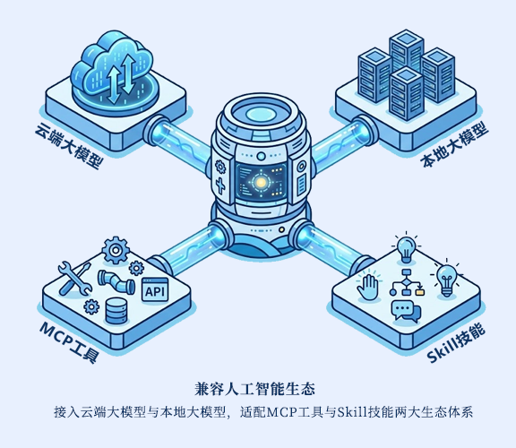
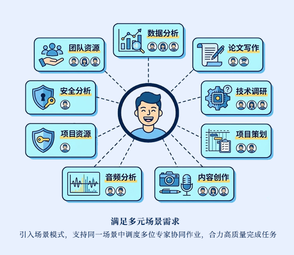
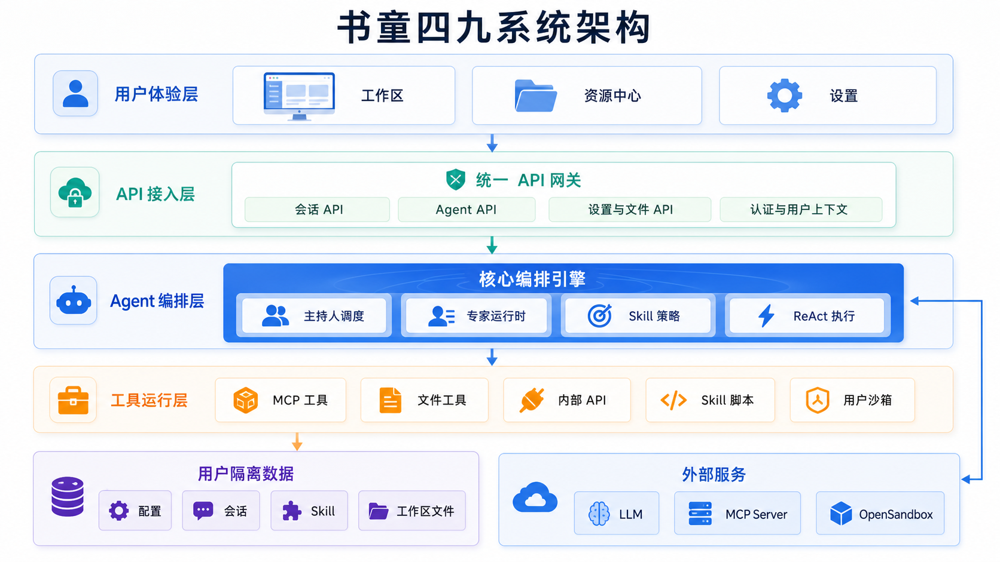

# 书童四九（Shutong Sijiu）

**支持私有化部署的多 Agent 协作与工具执行平台。**

## 项目介绍

书童四九面向资料调研、内容写作、数据处理等需要多角色协作与工具执行的任务，将大模型、专家角色、Skills、MCP 工具和工作区文件整合到同一个 Web 工作空间。用户可以配置不同专长的 AI 专家，通过场景复用专家组合，由主持人调度专家分工完成任务，也可以通过 `@` 指定专家参与。

项目覆盖从任务对话到脚本执行、文件产物交付的完整流程：专家通过 ReAct 循环调用模型与工具，Skill 描述工作方法并按需携带脚本，MCP 接入外部能力，OpenSandbox 提供用户级脚本运行环境。会话、资源配置与工作区文件按用户隔离，便于在私有化环境中管理和复用 AI 能力。

<table>
  <tr>
    <td width="50%"></td>
    <td width="50%"></td>
  </tr>
</table>

*功能示意：模型与工具接入，以及面向不同任务的多专家协作。*

### 核心能力

- **多专家协作与会话编排**：单专家与多专家共用统一会话模型，支持主持人调度、指定专家、阶段确认与后续接续；通过 SSE 展示运行进度和回复。
- **Skills 与 MCP 扩展**：以 `SKILL.md` 管理可复用工作流，支持流程型与脚本型技能；根据专家配置选择技能，并按技能声明装配外部工具。
- **用户级沙箱执行**：通过 OpenSandbox 执行技能脚本，支持运行依赖配置、工作区挂载与 Skill 资源只读挂载，可选择带 Playwright / Chromium 的镜像。
- **文件与产物管理**：在会话中上传、引用、预览和编辑工作区文件，将任务过程与交付产物放在同一工作空间。
- **资源复用与用户隔离**：集中管理场景、专家、技能、工具和模型，支持 ZIP 资源包导入导出；按用户隔离保存会话、配置、技能与文件。

### 技术栈

| 层次 | 技术与实现 |
| --- | --- |
| 前端 | Vue 3、TypeScript、Vite、Pinia、Vue Router、Tailwind CSS |
| 后端 | Python、FastAPI、Pydantic、REST API、SSE 流式通信 |
| Agent 与工具 | 主持人 / 专家编排、ReAct、LiteLLM、MCP、Skills |
| 执行与部署 | OpenSandbox、Docker、用户级文件存储、SQLite 账号存储 |

### 系统架构

系统分为用户体验、API 接入、Agent 编排和工具运行四层，并由用户隔离数据与外部模型 / 工具服务提供支撑。

详细模块边界与扩展入口见 [系统架构说明](docs/architecture/system-architecture.md)。

## 开发与文档

当前架构已统一为：

- 会话主入口：`/api/sessions/*`（单人与多人共用同一套带主持人的会话模型）
- Agent 主入口：`/api/agents/*`（专家资源包导入导出沿用 `/api/dha/instances/*`）

- 前端：见 [frontend/README.md](frontend/README.md)
- 后端：见 [backend/README.md](backend/README.md)
- 文档中心：见 [docs/README.md](docs/README.md)
- 发布入口：见 [docs/release/README.md](docs/release/README.md)
- 用户使用说明：见 [docs/user-manual/user-guide.md](docs/user-manual/user-guide.md)
- 程序运行逻辑与接口契约：见 [docs/contracts/runtime-interface-contract.md](docs/contracts/runtime-interface-contract.md)
- 数据结构与字段逻辑：见 [docs/contracts/data-structure-and-field-logic.md](docs/contracts/data-structure-and-field-logic.md)
- 上线前模块化测试操作手册（可在其他机器复现）：见 [docs/testing/pre-release-testing.md](docs/testing/pre-release-testing.md)

## 沙箱镜像

沙箱镜像版本映射（同一仓库 `crpi-hzqv5l81v3ftz5jl.cn-beijing.personal.cr.aliyuncs.com/free4inno-yuanfang2025/sandbox`）：

| 标签 | 对应版本 | Dockerfile | 说明 |
| --- | --- | --- | --- |
| `26.05.12.1-standard` | 普通版 | `docker/skill-sandbox/Dockerfile` | 轻量沙箱，不内置 Playwright/Chromium |
| `26.05.15-playwright` | Playwright 版 | `docker/skill-sandbox/Dockerfile.playwright` | 内置 Playwright/Chromium、Patchright、爬虫公共依赖，额外包含 `sqlite3` 与 `aiosqlite` |
